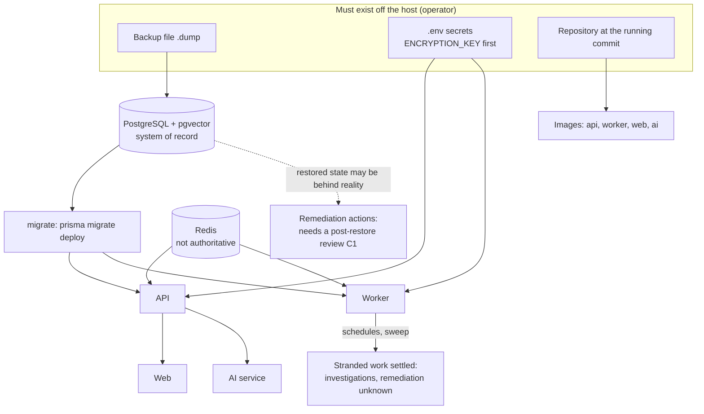

# Recovery readiness audit

Milestone 15, phase 1. An investigation of how OPSILUME recovers from loss and failure, as the repository stands at `develop` `43b7e91` (16 November 2026). Nothing was changed to produce it: no code, configuration, infrastructure or backup. Every statement below is tied to a file or to a recorded run; where something was not observed, it says so.

## 1. Executive summary

OPSILUME has a sound foundation for recovering **a running installation from a process or dependency failure**, and a working, tested tool for **taking and verifying a logical backup**. It has no means of recovering **an installation that has lost its host or its database volume** unless an operator has set up, outside the repository, everything the tool leaves to them: a schedule, an off-host copy, encryption, and a separate copy of the secrets.

What works, with evidence from CI's run on the PR #37 head (`8395cf0`, 16 November 2026):
- **Failure drills: 11 of 11 passed.** They cover:
  - the worker killed and stopped mid-investigation;
  - the AI service, Redis and PostgreSQL each stopped and started;
  - Redis killed and Redis wiped while work was waiting;
  - the whole stack stopped and started.

  The application recovered without manual intervention in every case.
- **Backup drill: 9 of 9 steps passed** with the backup tool:
  - `pg_dump`, then a restore beside the original;
  - a full comparison of the two databases;
  - the application run against the restored copy;
  - detection of damaged files, safe rotation, and loud failure.
- **Redis holds no authoritative data.** PostgreSQL is the system of record, and losing Redis's data was drilled.
- **Remediation dispatch never goes through the queue,** so losing or recovering Redis cannot send a webhook twice.

What does not exist:
- **Scheduling:** no backup is ever taken unless an operator installs a schedule.
- **Off-host copies, backup encryption and protection against deletion.**
- **Point-in-time recovery, replication and a tested restore on a different host.**
- **Recovery objectives:** no RPO or RTO is defined anywhere.
- **Post-restore safety for remediation:** nothing handles what a restored database says about remediation actions.

Findings: **2 critical, 3 high, 7 medium, 6 low** (section 9).
- **C1:** restoring a backup can make an already-executed production change executable again.
- **C2:** an installation as shipped keeps no backup at all and no copy off the host.

The roadmap (section 11) starts with these two.

## 2. Current backup architecture

**Implementation:**
- `scripts/backup.mjs`, run as `npm run backup -- create | verify | status`. The behaviour is documented in `docs/backup-and-restore.md`, which matches the code.
- The drill is `scripts/backup-restore-drill.mjs` (`npm run drill:backup`). CI runs it on every pull request, in the "Browser end-to-end tests" job of `.github/workflows/e2e.yml`.

| Question | Answer | Evidence |
|---|---|---|
| 1. How are backups created? | By hand, or by a scheduler the operator installs. `create` runs `pg_dump` inside the PostgreSQL container, streams it to `<dir>/opsilume-YYYYMMDD-HHMMSS.dump.partial`, checks it, then renames it | `scripts/backup.mjs:120-136` |
| 2. Logical or physical? | **Logical only** (`pg_dump --format=custom`). No physical backup, no `pg_basebackup`, no volume snapshot | `scripts/backup.mjs:120` |
| 3. Where are files stored? | In the `--dir` given, on whatever machine runs the command. Nothing is copied anywhere else | `scripts/backup.mjs:107-112`; `docs/backup-and-restore.md:38` |
| 4. Encrypted? | **No.** Files are created with mode `0600` | `scripts/backup.mjs:123`; `docs/backup-and-restore.md:38,142` |
| 5. Compressed? | Yes: the custom format is compressed by default. CI's drill: 37,167 rows in 0.9 MB | CI drill output |
| 6. Integrity verified? | Yes, at creation: `pg_restore --list` reads the table of contents (and a file with no table data is refused), then a SHA-256 is recorded in `backups.json`. With `--verify-restore`, also a full restore into a scratch database, row counts compared and foreign keys checked. `verify` re-checks the checksum and readability later | `scripts/backup.mjs:59-98,128-136,166-187` |
| 7. Scheduling? | **None implemented.** The cron lines in the document are examples that were "written, not run" | `docs/backup-and-restore.md:40-50,141` |
| 8. Retention? | Only `--keep N` (the N newest backups this tool made). No daily/weekly/monthly scheme, no time-based expiry. Without `--keep`, nothing is ever deleted | `scripts/backup.mjs:138-148`; `docs/backup-and-restore.md:52-54` |
| 9. Survives host loss? | **Only if the operator copies backups off the host.** The tool doesn't, and the default `--dir` sits on the same machine as the database | `docs/backup-and-restore.md:38,142` |
| 10. Deletion and ransomware protection? | **None.** Files and the checksum manifest share a directory owned by the operator's user. Anyone who can delete or alter a backup can alter `backups.json` too | `scripts/backup.mjs:22,99-103` |
| 11. Restore without the original environment? | Documented (`docs/backup-and-restore.md:109`), **never tested**. The tool's own restore test runs on the same PostgreSQL server as the source | `scripts/backup.mjs:77-98`; `docs/backup-and-restore.md:141` |
| 12. Credentials handled safely? | The tool reads no `.env` and no Compose file; it finds the container by its Compose labels. But the dump contains: • password hashes, refresh-token, API-key and idempotency-key hashes; • GitHub tokens and webhook secrets encrypted with `ENCRYPTION_KEY`; • **the remediation webhook URL in plaintext**, which can carry a token; • the audit log and all ingested logs. | `scripts/backup.mjs:38-46`; `apps/api/prisma/schema.prisma:67-68,76,107,121,137,522-523` |

**Implemented versus documented intentions.** All the tool behaviour in the table is implemented and drilled. Scheduling, off-host copies, encryption and a restore on a new machine appear only as advice in `docs/backup-and-restore.md`; none of them is implemented or tested.

**About the 611,104 rows.** That figure is one local run on 15 November 2026 (`docs/pilot-acceptance-report.md:161`). CI's run on 16 November backed up and restored **37,167 rows** (0.9 MB: dump 15.2 s, restore 1.0 s, comparison 12.2 s). Both runs passed. The larger figure is not what CI exercises on each pull request (finding L1).

## 3. PostgreSQL recovery assessment

**Configuration:**
- **Image and storage:** `pgvector/pgvector:pg16`, data on the named volume `pgdata`, `restart: unless-stopped` (`docker-compose.yml:43-59`).
- **Initialisation:** `infra/postgres/init.sql` runs once when the volume is created. It creates the `vector` extension and a second database, `opsilume_test`.
- **No PostgreSQL settings are configured in the repository:** no `command`, no `postgresql.conf` and no `-c` flags. WAL level, archiving, checkpoints and `fsync` are the image defaults. I didn't query their values; they are not set in the repository.

| Capability | Status | Evidence |
|---|---|---|
| Full database restore | **Supported and drilled** on the same server: restore into a new database, compare, run the application against it | CI drill; `docs/backup-and-restore.md:88-120` |
| Selective recovery (one organisation, one table) | **Not supported.** Documented workaround: restore the whole backup separately and copy by hand | `docs/backup-and-restore.md:170-172` |
| Point-in-time recovery | **Not supported.** No WAL archiving, no base backups; the document says so | `docs/backup-and-restore.md:5,86` |
| Recovery from a corrupted backup | **Detection only.** A damaged file is refused (drilled); recovery means falling back to an older good backup, and only if one was kept | CI drill step "a damaged backup is recognised" |
| Recovery after complete host loss | **Not demonstrated.** It needs an off-host backup (not provided), the original `ENCRYPTION_KEY`, a PostgreSQL image with pgvector, and a different database name in `DATABASE_URL`, which is fixed in `docker-compose.yml:17` and must be overridden | `docs/backup-and-restore.md:101-109` |
| Migrations after a restore | Forward-only: `migrate deploy` runs on every start. An older backup under newer code "follows from how migrations work and was not tested"; a newer backup under older code is unsupported | `docker-compose.yml:78-89`; `docs/backup-and-restore.md:107` |
| Startup readiness | The database is health-checked with `pg_isready`. `migrate` waits for it; the API and worker wait for `migrate` and Redis | `docker-compose.yml:55-59,85-105` |
| Connection recovery after an outage | **Drilled.** During a PostgreSQL stop the API answers 503 without detail; afterwards the same processes and sessions work and the data is unchanged. The API starts even if the database is down (Prisma connects lazily) and reports not-ready on `/ready` | CI drill `postgres-down` (8 s); `apps/api/src/server.ts`; `apps/api/src/modules/system.ts:109` |
| Integrity validation after a restore | Row counts, foreign-key validity, indexes (including the vector index), extensions, migration history and content digests of 7 tables, in the drill. The operator procedure only suggests a few counts and the last audit date | CI drill; `docs/backup-and-restore.md:111-120` |

## 4. Redis and BullMQ recovery assessment

**Configuration and behaviour:**
- **Persistence:** append-only file, `appendfsync everysec`, on the volume `redisdata` (`docker-compose.yml:61-74`). A killed Redis loses about a second of queue changes.
- **Not authoritative:** Redis holds only queued work and the repeating schedules (`docs/backup-and-restore.md:154-168`).
- **Retry settings per queue** (`apps/api/src/queues/index.ts:45-50,145-151`):

  | Queue | Attempts |
  |---|---|
  | `investigation` | 1 |
  | `knowledge-index` | 3 |
  | `github-sync` | 2 |
  | `alert-eval` | 1 |
  | `log-retention` | 1 |

  Retries use exponential backoff, starting at `QUEUE_BACKOFF_MS` (5 s). Completed jobs are kept for 24 h, failed ones for 7 days.
- **Stalled jobs:** `lockDuration` and `stalledInterval` are both 30 s (`queues/index.ts:174-175`; `config/env.ts:55-56`). A job whose worker died is detected as stalled and redelivered.
- **Repeating schedules** (`alert-eval` every minute, `log-retention` every hour) are re-created by the worker within a minute if Redis loses them (`queues/index.ts:186-193,219-233`).

**Can work run twice after recovery?**
- **Investigations:** at most once. Attempts is 1, the run is started by a conditional update, and a redelivered job is recorded as interrupted rather than run again (`modules/investigations/runner.ts:40-55`). Drilled: `worker-killed` recorded the run as interrupted, not re-run; `queue-wiped` ran the waiting investigation "once".
- **Knowledge indexing** can run more than once and is idempotent: it replaces the document's chunks in one transaction (`modules/knowledge.ts:35-60`).
- **GitHub synchronisation** can run more than once and is idempotent: it upserts commits and pull requests (`modules/github.ts:35-65`).
- **Remediation is not queued.** The webhook is dispatched inside the execute request (`modules/remediation/routes.ts:189`; `execution.ts:66-71`), so no queue retry or recovery can dispatch it. The existing guarantees hold:
  - no automatic retry of an unknown outcome;
  - a retry only after "not applied";
  - a single claim per attempt.

**If Redis is lost completely while PostgreSQL survives** (drilled as `queue-wiped`, 125 s):
- schedules come back within a minute;
- a waiting investigation is re-queued by the sweep after two minutes and runs once;
- a running investigation is ended as interrupted.

Not drilled:
- a queued GitHub synchronisation is lost (documented);
- documents being indexed are picked up again after ten minutes (documented).

**Dependency to note.** The sweep that settles stranded remediation executions runs inside the `alert-eval` repeating job (`modules/system.ts:17-21,50-66`). While Redis or the worker is down, an `EXECUTING` action is not settled. That is safe, since nothing is sent, but it stays `EXECUTING` until both are back (finding M4).

## 5. Application recovery assessment

| Event | Restarts by itself | Health shows real readiness | Work afterwards | Evidence |
|---|---|---|---|---|
| API process restart | Yes (`restart: unless-stopped`) | Yes: `/ready` checks PostgreSQL and Redis | A remediation execution in flight is left `EXECUTING`; the sweep records it as `unknown` after `REMEDIATION_EXECUTION_STALE_MINUTES` (10) for a person to reconcile. **No drill kills the API mid-execution**; covered by API tests only | `docker-compose.yml:91-112`; `modules/system.ts:50-66`; `apps/api/tests/reconciliation.test.ts`, `audit-durability.test.ts` |
| Worker restart | Yes; 30 s stop grace | Yes: `/ready` checks PostgreSQL and Redis | SIGTERM: running jobs get 10 s, then are recorded as interrupted. SIGKILL: the redelivered job is recorded as interrupted | `docker-compose.yml:114-133`; `src/worker.ts`; drills `worker-stopped` (27 s), `worker-killed` (67 s) |
| AI service restart | Yes | **Liveness only:** `/health` does not check that it can reach the API | Investigations fail with "AI service is not reachable" during the outage, and work after it | `services/ai/app/main.py:64`; drill `ai-down` (18 s) |
| Container restart | Yes, all long-running services | See rows above. The web check loads `/login` only | Drilled as a whole-stack stop and start | drill `restart` (35 s) |
| Full host restart | Expected to work through Docker's restart policies. **Not drilled:** the `restart` drill is an orderly stop and start with volumes intact | — | — |
| Network interruption | Not drilled as such. Redis and PostgreSQL outages stand in for it | — | drills `redis-down`, `postgres-down` |
| Database down at start-up | `migrate` waits for its health check; the API itself starts and reports not ready | Yes | Not drilled at start-up; drilled while running | `docker-compose.yml:85-89`; `src/server.ts` |
| Redis down at start-up | The API and worker wait for Redis's health check. The producer connection fails fast, so requests are refused with 503 | Yes | Drilled while running | `queues/index.ts:82-105`; drill `redis-down` |

**Unknown outcomes versus confirmed failures.** The system keeps them apart:
- A timeout, dropped connection or 5xx from the webhook, and an execution stranded by a crash, are recorded as outcome `unknown`, never as failed.
- Only `not_applied` (a 4xx, a refused destination, or a person's reconciliation) allows a retry (`modules/remediation/execution.ts`, `routes.ts:381`).

## 6. Critical data inventory

| Data | Where | Authoritative? | If lost |
|---|---|---|---|
| Organisations, accounts, services, incidents, telemetry, investigations, evidence, knowledge and embeddings | PostgreSQL | **Yes** | Restore from backup; everything since the backup is gone |
| **Remediation actions, approvals, execution attempts and results, reconciliations** | PostgreSQL (`RemediationAction`, `Approval`) | **Yes** | As above. A restore can leave the record **behind reality** (finding C1) |
| **Audit log** | PostgreSQL (`AuditLog`); durable with its transition since Milestone 14 | **Yes** | As above: entries after the backup are gone |
| Queued jobs and schedules | Redis (`redisdata`) | No | Regenerated (section 4) |
| Uploaded or local files | None: the API and AI service write no files; knowledge documents are stored in PostgreSQL | — | — |
| `ENCRYPTION_KEY` | `.env` | **Yes, for the encrypted columns** | GitHub tokens and webhook secrets in every backup become unreadable and must be entered again |
| `JWT_SECRET`, `INTERNAL_SERVICE_TOKEN`, database password | `.env` | Configuration | Regenerate; everyone is signed out |
| GitHub integration credentials | PostgreSQL, encrypted (`schema.prisma:522-523`); optional `GITHUB_TOKEN` in `.env` | Yes (encrypted) | Re-enter |
| AI provider configuration and keys | `.env` | Configuration | Re-enter; the rule-based engine needs none |
| Monitoring and tracing configuration | `infra/` in the repository; traces in memory | No | Rebuilt from the repository |
| Backup encryption keys | None exist (backups are not encrypted) | — | — |
| Application code | Repository, at the commit that was running | No | Rebuild; the commit must be known |

### Recovery dependencies

**Restore order:**
1. Host, Docker and the repository at the right commit.
2. The `.env` secrets, with the original `ENCRYPTION_KEY`.
3. PostgreSQL alone; restore the backup into a new database and check it.
4. Point `DATABASE_URL` at it.
5. Redis (empty is fine).
6. `migrate`, then the API, worker, AI service and web.
7. Review remediation actions before anyone executes anything (C1; no procedure exists today).

## 7. Recovery objectives

**No RPO or RTO is defined** in the code, the configuration or the documentation. The only related text is "your recovery point is your newest good backup" (`docs/backup-and-restore.md:78`).

The observed times below come from one CI run (16 November 2026, GitHub-hosted runner, isolated stack, 37,167 rows) unless stated otherwise. They are durations of drills, not measured recovery times for a real installation.

| Failure scenario | Current recovery capability | Observed recovery time | Data loss exposure | Proposed RPO | Proposed RTO |
|---|---|---|---|---|---|
| PostgreSQL outage | Automatic; the same processes resume | Drill took 8 s (outage plus recovery) | None (volume intact) | Pending decision | Pending decision |
| PostgreSQL data corruption | Manual restore of the newest good backup into a new database | Restore 1.0 s at 37,167 rows (CI); 5.0 s at 611,104 rows (local, 15 November). **End-to-end operator time unknown** | Everything since the last backup. **Unbounded if no schedule exists** | Pending decision | Pending decision |
| Redis loss | Automatic | 121 s until the waiting investigation completed | About 1 s of queue changes (AOF), or a queued GitHub sync | Pending decision | Pending decision |
| Worker crash | Automatic | Interrupted run recorded 61 s after the new worker started | The running investigation must be started again by a person | Pending decision | Pending decision |
| Host loss | **Manual, untested.** Requires an off-host backup and `.env` that the repository does not provide | **Unknown** | **Total**, unless the operator keeps off-host copies | Pending decision | Pending decision |
| Backup corruption | Detected by `verify` and `status`; fall back to an older backup | **Unknown** | Back to the newest good backup, if one was kept | Pending decision | Pending decision |

## 8. Existing recovery test coverage

| Area | Covered by | Status |
|---|---|---|
| PostgreSQL outage and recovery | drill `postgres-down`; `apps/api/tests/outage.test.ts` (TCP fault proxy) | Covered |
| Redis outage and recovery | drills `redis-down`, `queued-job-survives-redis-kill`; `outage.test.ts` | Covered |
| Worker interruption | drills `worker-killed`, `worker-stopped`; `reliability.test.ts` | Covered |
| API restart | drill `restart` (whole stack) | Partial: never mid-request |
| Backup creation | `drill:backup` steps 2 and 6 | Covered |
| Backup integrity validation | `drill:backup` step 7 (truncated, altered, not a backup) | Covered |
| Full restore | `drill:backup` step 3 (same server) | Partial: same server and version only |
| Restore verification | `drill:backup` steps 4–5 | Covered |
| Data consistency | `drill:backup` step 4 (counts, keys, indexes, digests) | Covered |
| Queue recovery | drill `queue-wiped`; `queue.test.ts` | Covered for investigations; not for knowledge indexing or GitHub sync |
| Duplicate execution prevention | `reliability.test.ts`, `execution-integrity.test.ts`, `remediation-consistency.test.ts` | Covered in API tests |
| Interrupted remediation execution | `reconciliation.test.ts`, `audit-durability.test.ts` (sweep) | Covered in API tests; **no drill against real containers** |

**Missing drills:**
- restore on a fresh host or VM, from an off-host copy, with only the documented procedure;
- **remediation state after a restore** (C1);
- the API killed during a webhook dispatch, against real containers;
- a host or Docker daemon restart (as opposed to `compose stop/start`);
- a restore under a newer application version;
- a full backup disk;
- loss of `ENCRYPTION_KEY`;
- the scheduler examples, which have never been run.

**What this audit did and did not run.** I ran no destructive experiment. CI runs every drill above on each pull request against the isolated stack only.

## 9. Recovery gaps and risks

Severity follows the brief:
- **Critical:** risk of unrecoverable data loss or unsafe operational execution.
- **High:** a significant recovery weakness.
- **Medium:** missing automation, validation or documentation.
- **Low:** convenience or a minor documentation issue.

"Kind" says what a fix requires: infrastructure, application code or operational policy.

### Critical

**C1. A restored database can make an already-executed production change executable again.**
- **Evidence:**
  - Approvals count for `REMEDIATION_APPROVAL_VALIDITY_HOURS` (default 24) by the database clock (`modules/remediation/approvals.ts:26`).
  - A restore brings back each action in the state it had at backup time. Execution and retry are allowed from those states (`routes.ts:189,381`).
  - The restore guide covers investigations after a restore but not remediation (`docs/backup-and-restore.md:168`).
- **Behaviour.** Take a backup in which an action is `APPROVED`, or `FAILED` with outcome `not_applied`. The action is then executed, or retried and applied, before the database is lost. After a restore from that backup, within the approval window, the action is again executable or retryable with valid approvals. A person can dispatch the same change a second time.
  - The only protection is downstream: the webhook carries `idempotency-key: <action id>` (`execution.ts:68`), which deduplicates only if the receiver honours it.
  - The audit and timeline entries for the first execution are gone with everything else after the backup.
- **Impact.** A production change (restart, rollback, configuration) applied twice, contradicting the "no duplicate dispatch" guarantee. Conditions: a restore from a backup less than 24 hours old, an action approved before the backup and executed after it, and a person executing it again.
- **Fix.**
  1. A post-restore step that makes no restored action executable without a fresh decision:
     - supersede the approvals of `APPROVED` actions;
     - mark `FAILED` and `EXECUTING` actions as needing reconciliation;
     - record all of this in the audit log.
  2. A runbook step that requires it before the application is opened to users.
  3. A drill that restores a backup taken before an execution.
- **Kind:** application code plus operational policy.

**C2. An installation as shipped keeps no backup and no off-host copy.**
- **Evidence:**
  - Scheduling is not implemented (`docs/backup-and-restore.md:40-50`).
  - The tool writes only to a local `--dir` (`scripts/backup.mjs:107-112`).
  - Off-host copies are "not provided" (`docs/backup-and-restore.md:142`).
  - No backup variable or setting exists in `.env.example`.
- **Behaviour.** Unless an operator installs a scheduler and a copy job, the only copy of all data is the `pgdata` volume on one host.
- **Impact.** Losing the volume or the host loses everything permanently, including the audit history and the remediation record.
- **Fix:**
  - a tested, shipped schedule (systemd timer or cron unit) that runs `create --verify-restore --keep N` and `status`;
  - an off-host copy step;
  - an alert when `status` fails.
- **Kind:** infrastructure plus operational policy.

### High

**H1. Backups are unencrypted and have no protection against deletion or tampering.**
- **Evidence:**
  - Mode `0600` only (`scripts/backup.mjs:123`).
  - The checksum manifest sits beside the files (`:22,99-103`).
  - No immutability.
- **Behaviour.** A backup holds:
  - password and token hashes;
  - credentials encrypted with `ENCRYPTION_KEY`;
  - the plaintext remediation webhook URL (`schema.prisma:67`), which can embed a token;
  - the audit log and all ingested logs.

  Anyone with the operator's file access can read, delete or alter backups and their recorded checksums together.
- **Impact.** Disclosure if a backup leaks. A single compromise of the host (ransomware, a mistaken `rm`) destroys the live data and every backup at once.
- **Fix:**
  - encrypt before the file leaves the host (for example, `age` to a public key whose private key is kept offline);
  - store the off-host copy in append-only or object-locked storage;
  - keep checksums in a second place.
- **Kind:** infrastructure plus operational policy.

**H2. Restoring onto a new host has never been tested, and the procedure needs a configuration edit.**
- **Evidence:**
  - Restore on another machine or PostgreSQL version is "not tested" (`docs/backup-and-restore.md:141`).
  - `DATABASE_URL` names the database `opsilume` in `docker-compose.yml:17`; restoring into a new database needs an edit or an override (`docs/backup-and-restore.md:101-104`).
  - The dump needs a server with pgvector.
- **Impact.** The one procedure that matters after host loss is the least proven, and the recovery time for host loss is unknown.
- **Fix:**
  - a drill that rebuilds from nothing on a clean machine or VM, using only the off-host backup, the `.env` and the documented steps;
  - a supported way to restore into the database name the stack already uses (stop the application, restore into `opsilume`, check);
  - a measured end-to-end time.
- **Kind:** operational policy plus a small infrastructure change.

**H3. `ENCRYPTION_KEY` and the other secrets have no defined backup, escrow or rotation procedure.**
- **Evidence:** "Keep them separately" is the whole procedure (`docs/backup-and-restore.md:12,149`). There is no key-rotation tool for the encrypted columns (`schema.prisma:68,522-523`).
- **Impact:**
  - Restoring without the key loses every stored GitHub token and webhook secret; integrations stop until they are re-entered.
  - A key kept beside the backups gives a reader of the backups those credentials.
- **Fix:**
  - a written secret-custody procedure (where the key lives, who holds it, how it is tested);
  - a drill that restores with the key retrieved from that custody;
  - optionally, a rotation command.
- **Kind:** operational policy, optionally application code.

### Medium

**M1. No recovery objectives are defined.**
- **Evidence:** nothing in the code, configuration or documentation (section 7).
- **Impact:** nobody can say whether the backup interval or recovery time is acceptable.
- **Fix:** decide RPO and RTO per scenario (section 7 table).
- **Kind:** policy.

**M2. There is no point-in-time recovery.**
- **Evidence:** `docs/backup-and-restore.md:5,86`; no WAL archiving is configured.
- **Impact:** the recovery point is the backup interval. Everything in between is lost: approvals, executions, audit entries.
- **Fix:** decide after M1. If the agreed RPO is shorter than a practical dump interval, add WAL archiving with a maintained tool (pgBackRest or WAL-G) to off-host storage. Otherwise, document the decision not to.
- **Kind:** infrastructure plus policy.

**M3. Removing an organisation does not remove it from backups.**
- **Evidence:** `org:remove` deletes live rows only (`apps/api/src/lib/removeOrganization.ts`). Backups are kept until rotated, with no time limit.
- **Impact:** the deleted organisation's data persists in every retained backup, and a restore brings it back.
- **Fix:**
  - a retention period for backups;
  - documentation that deletion takes effect in backups only when they expire;
  - a post-restore step that re-applies removals made after the backup.
- **Kind:** policy, possibly code.

**M4. Stranded remediation executions are settled only by the worker's scheduled job, which needs Redis.**
- **Evidence:** `modules/system.ts:17-21,50-66`; `queues/index.ts:186-193`.
- **Impact:** while Redis or the worker is down, an `EXECUTING` action stays `EXECUTING`. That is safe (nothing is sent), but no one can reconcile or retry it until both return.
- **Fix:** either document this, or also run the remediation part of the sweep from a timer in the worker that doesn't depend on the queue.
- **Kind:** code or documentation.

**M5. Restore verification runs on the production server and compares counts taken before the dump.**
- **Evidence:** `scripts/backup.mjs:77-98,116-117`; `docs/backup-and-restore.md:36`.
- **Impact:**
  - It proves the file restores on this server, not on a new one.
  - It needs disk for a second copy and can report false differences on a busy database.
- **Fix:** scheduled restore tests on a separate machine or the isolated stack, with the counts taken from the dump's own snapshot.
- **Kind:** infrastructure.

**M6. No drill kills the API during a webhook dispatch against real containers.**
- **Evidence:** the drill list in `scripts/reliability-drills.mjs:124-348`. This is covered only by API tests.
- **Impact:** the end-to-end behaviour (stranded execution, sweep, reconcile) has not been shown on the real stack.
- **Fix:** add a drill with a local stand-in webhook that blocks, kill the API, and check for `unknown` and reconciliation.
- **Kind:** test infrastructure.

**M7. Host restart and Docker daemon restart are not drilled.**
- **Evidence:** the `restart` drill stops and starts the Compose project with volumes intact (`scripts/reliability-drills.mjs:312`).
- **Impact:** restart policies and dependency order after a real reboot are assumed, not shown. `depends_on` ordering is not applied when the daemon restarts containers.
- **Fix:** a drill on a VM with a reboot.
- **Kind:** test infrastructure.

### Low

**L1. The backup document's 611,000-row figure sits next to "runs in CI on every pull request".**
- **Evidence:** `docs/backup-and-restore.md:124-129`. The sentence does say "Last run locally on 15 November 2026", but the table that follows doesn't say that CI's run is much smaller.
- **Impact:** a reader could assume CI restores 611,000 rows. It restores about 37,000.
- **Fix:** state the scale of each run.
- **Kind:** documentation.

**L2. The AI service's health check is liveness only.**
- **Evidence:** `services/ai/app/main.py:64`; `docker-compose.yml:164`.
- **Impact:** "healthy" does not mean it can reach the API's tools.
- **Fix:** a readiness endpoint, if needed.
- **Kind:** code.

**L3. The web health check loads `/login` only.**
- **Evidence:** `docker-compose.yml:180`.
- **Impact:** signed-in pages and the API proxy aren't exercised (relevant to the PR #35 browser flake).
- **Fix:** check a proxied API path.
- **Kind:** infrastructure.

**L4. `opsilume_test` is created inside the production cluster.**
- **Evidence:** `infra/postgres/init.sql:3-5`.
- **Impact:** a test database beside production data, not covered by backups. That is harmless, but confusing during recovery.
- **Fix:** create it only in development or the isolated stack.
- **Kind:** infrastructure.

**L5. Recovery of knowledge indexing and GitHub synchronisation after a Redis loss is documented but not drilled.**
- **Evidence:** `docs/backup-and-restore.md:163-166`.
- **Fix:** extend `queue-wiped`.
- **Kind:** test.

**L6. A restore needs a pgvector-enabled PostgreSQL 16.**
- **Evidence:** `docker-compose.yml:45`; `init.sql:2`. This is not stated in the restore procedure.
- **Impact:** a restore onto stock PostgreSQL fails at `CREATE EXTENSION vector`.
- **Fix:** state it in the procedure.
- **Kind:** documentation.

## 10. RPO/RTO decision table

The proposed objectives are left for the owner. See section 7 for the table with current capability, observed times and exposure. The decisions needed:
1. **The RPO for PostgreSQL data:** this fixes the backup interval, and whether point-in-time recovery (M2) is needed.
2. **The RTO for host loss:** this fixes whether a documented manual rebuild (H2) is enough or a standby is needed.
3. **How long backups are kept:** this fixes retention and the effect of organisation removal (M3).
4. **Who holds `ENCRYPTION_KEY` and the backup encryption key:** H1 and H3.

## 11. Prioritised remediation roadmap

Proposed only. Nothing here is started.

| Order | Milestone | Addresses | Kind | Depends on |
|---|---|---|---|---|
| 1 | **Post-restore remediation safety.** A command run after any restore, before users return, that supersedes approvals of restored `APPROVED` actions and marks `FAILED` and `EXECUTING` actions for reconciliation, all audited. A runbook step that requires it. A drill that restores a backup taken before an execution and proves the action cannot be dispatched again | C1 | Code, policy, test | — |
| 2 | **Backups that happen and leave the host.** A shipped systemd timer or cron unit for `create --verify-restore --keep N` and `status`, with alerting. Encryption before copy (`age`). Copy to a second location the owner chooses (a second disk or host first; no paid service assumed). Checksums kept beside the copy | C2, H1 | Infrastructure, policy | Decision 3; key custody (H3) |
| 3 | **Recovery objectives and secret custody.** Agree RPO and RTO per scenario. Write the `ENCRYPTION_KEY` custody procedure | M1, H3 | Policy | — |
| 4 | **Rebuild-from-nothing drill.** On a clean VM: the repository at a commit, `.env` from custody, the off-host backup, a restore into the stack's own database name, migrations, and the step 1 command. Measure the time. Fix the procedure where it fails (H2, L6) | H2, L6, M7 | Test, policy | 1, 2 |
| 5 | **Smaller recovery gaps:** sweep independence or documentation (M4), API-killed-during-dispatch drill (M6), restore test off the production server (M5), extended queue drill (L5), health checks (L2, L3), test database placement (L4), document scale (L1), backup retention and organisation removal (M3) | M3–M6, L1–L5 | Mixed | 3 |
| 6 | **Point-in-time recovery, only if decision 1 requires it.** WAL archiving with pgBackRest or WAL-G to the off-host location, with a restore-to-time drill | M2 | Infrastructure | 2, 3 |

Not recommended now:
- **Replication or high availability:** nothing in the findings requires it before objectives exist.
- **Redis backups:** Redis is not authoritative and its loss is drilled.

## 12. Limitations

- **Not measured on a real deployment.** The observed times come from one CI run on a GitHub-hosted runner with 37,167 rows, plus one earlier local run of the backup drill. No real installation was measured.
- **PostgreSQL settings not queried.** WAL and checkpoint values were not read from a running server; the repository sets none.
- **No experiments run by this audit.** No backup was created or restored, and no service was stopped. The evidence is the code, the documents and CI's recorded drill output.
- **Not examined:** the demo services (`demo/`) and the browser application's own recovery behaviour.
- **C1 is from reading the code.** Its conditions follow from the code (approval validity, the execute and retry routes) and have not been demonstrated by a drill; roadmap item 1 includes one.
- **Not a readiness claim.** This report does not claim pilot or production readiness.
